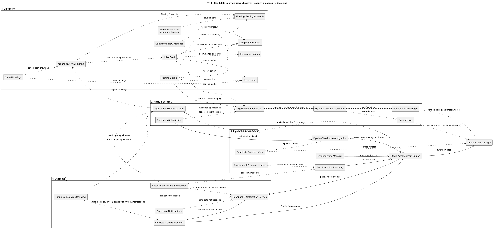
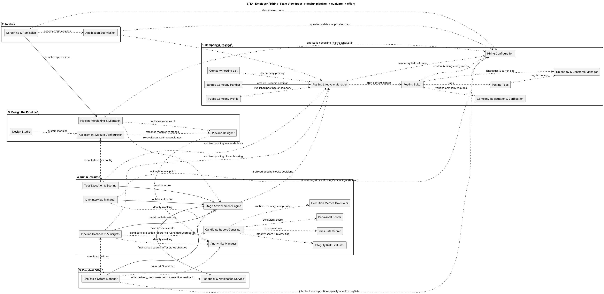
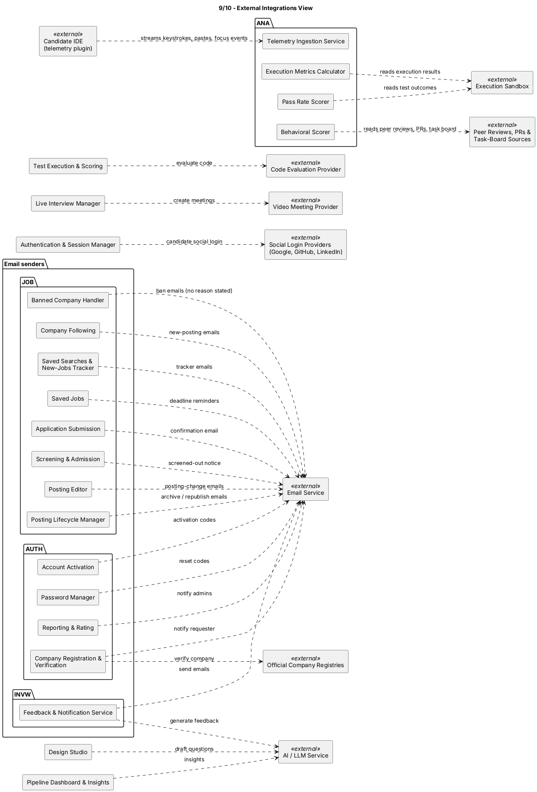
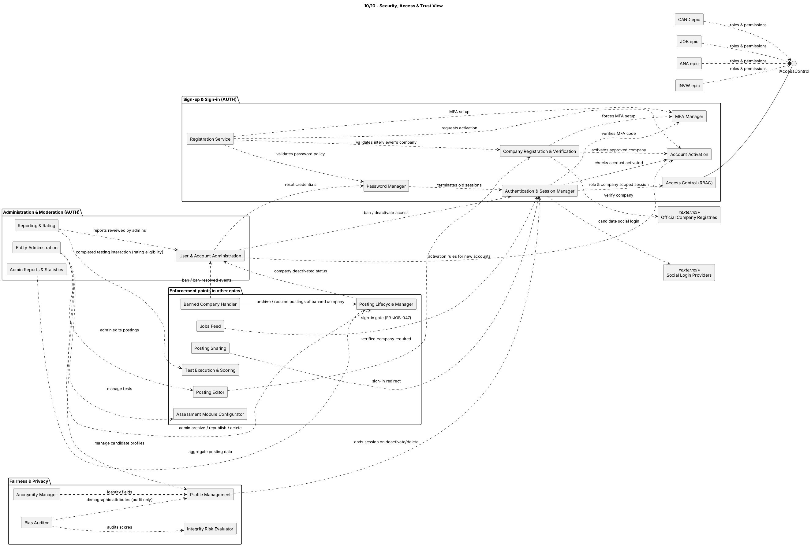

## 2. System overview

Owner: TBD | Status: Draft | Last updated: 2026-10-14 | Jira: TBD

### 2.1 Context

AMARA is a browser-based SaaS product for Computer Science-related hiring. Candidates discover and apply to published postings, complete screening and employer-defined pipeline stages, review disclosed results, and maintain a profile and dynamic resume. Employers configure postings and pipelines, evaluate application evidence, make configured advancement decisions, and manage finalists and offers. AUTH provides identity and authorization across these flows; ANA computes the analytics and evaluation artifacts defined by its epic.

The five epics are logical business modules, not five separately deployed services. JOB owns posting configuration, application intake, Must-have screening, and admission. INVW owns admitted applications, post-admission statuses and notifications, pipeline execution, and offers. CAND owns candidate-facing discovery/profile/resume interactions. AUTH owns accounts and access control. ANA consumes authorized data for analytics and does not write into another epic's records.

Figure 1. The epic-level context and integration view. [PlantUML source](src/06-view-overview.puml).

### 2.2 Major system components

| Component | Responsibility | Principal dependencies |
|---|---|---|
| Web client | Candidate, company, interviewer, and admin browser experiences; routes and localized presentation. | Go API; browser capabilities. |
| Go application backend | The modular monolith containing AUTH, CAND, JOB, INVW, and ANA modules, each with its own domain rules and write ownership. | Relational database, object storage, queues, provider adapters. |
| API execution role | Authenticated synchronous requests, validation, reads, and short transactional commands. | Domain modules; AUTH access-control policy. |
| Worker execution role | Retriable, scheduled, or long-running jobs such as notification delivery, screening, evaluation/report generation, and cleanup. | Queue, domain modules, external adapters. |
| Relational data store | Transactional account, posting, application, pipeline, assessment, decision, offer, and analytics records. | Backend repositories; tenant/company scoping. |
| Object storage | Resumes, submitted video, and other retained documents or artifacts. | AUTH/JOB/INVW/ANA storage adapters; retention lifecycle. |
| Message queue | Decouples asynchronous jobs from web requests and allows retry/worker scaling. | API/domain event producers and worker consumers. |
| External adapters | Isolate email, official registry, social login, meeting, code-evaluation, LLM, sandbox, IDE telemetry, and review-source integrations. | The corresponding external provider. |

### 2.3 Principal user journeys

1. **Discover and apply:** The signed-in Candidate uses CAND views over Published JOB posting data and submits an application through JOB. JOB validates, stores an immutable submission snapshot, screens against Must-have criteria, and hands admitted applications to INVW.
2. **Run the hiring workflow:** INVW places an admitted application into the published pipeline, schedules or presents assessments, records scores and decisions, manages feedback and anonymity, and moves the Candidate through stages. CAND displays permitted status and progress; ANA consumes approved source data for its analysis.
3. **Reach a final outcome:** INVW identifies Finalists after completion, manages offers and final application states, and owns notifications. CAND presents the offer/decision to the Candidate and accepts the Candidate's offer response.
4. **Manage a posting:** A Company Representative uses AUTH-controlled company access to create and publish a JOB posting; a Hiring Manager designs and operates its INVW pipeline. JOB posting capacity is read by INVW when evaluating finalist offers.

Figure 2. Candidate journey. [PlantUML source](src/07-view-candidate-journey.puml).

Figure 3. Employer flow. [PlantUML source](src/08-view-employer-flow.puml).

### 2.4 External systems

| External system | Used by | Purpose / failure boundary |
|---|---|---|
| Email service | AUTH, JOB-originated events, INVW | Activation, account recovery, posting/application notices, feedback, interview and offer notices. INVW owns notification policy and delivery behavior across the hiring workflow. |
| Official company registries | AUTH | Company verification input; unavailable checks must remain pending or enter the defined review path rather than silently validate a company. |
| Social login providers | AUTH | Optional Candidate sign-in through configured providers. |
| Video meeting provider | INVW | Create and manage scheduled live-interview meetings. |
| Code-evaluation provider | INVW | Evaluate coding submissions; an unavailable or invalid result remains pending, not a zero. |
| AI/LLM service | INVW | Optional design-studio drafts and configured feedback/insight generation; it does not independently determine a stage score. |
| Candidate IDE, execution sandbox, peer-review/PR/task-board sources | ANA | Provide the telemetry and execution/behavioral inputs specified by ANA; these inputs require privacy and integrity controls. |

Figure 4. External integrations. [PlantUML source](src/09-view-external-integrations.puml).

### 2.5 Users and access context

The principal human actors are Candidate, Interviewer, Hiring Manager/Company Representative, Guest, and System Administrator. AUTH authenticates users and applies role and company scope. A person may hold a company role, but posting/pipeline operations remain tied to the authorized company and posting. Guests can enter registration and public-information flows; JOB's protected discovery/application routes can return users to the requested route after sign-in. ANA is a system module whose outputs are consumed only by authorized views.

Security enforcement and identity disclosure are separate concerns: AUTH decides whether the caller may access a resource; INVW masks Candidate identity until the pipeline's reveal point. See `05-functional/auth.md`, `05-functional/invw.md`, and the security view.

Figure 5. Security/access-control view. [PlantUML source](src/10-view-security-access.puml).
