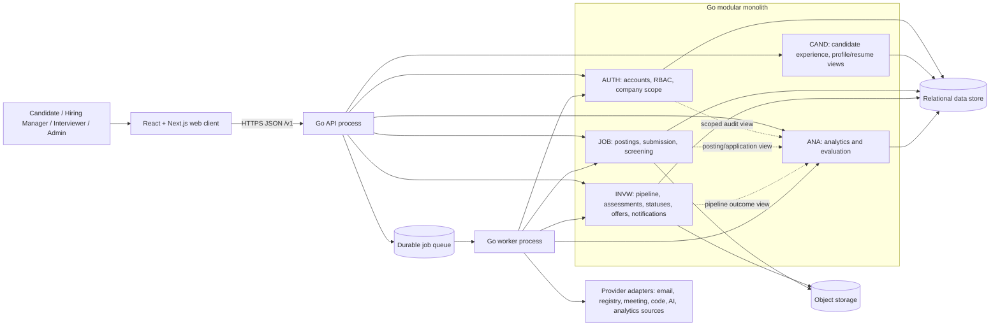
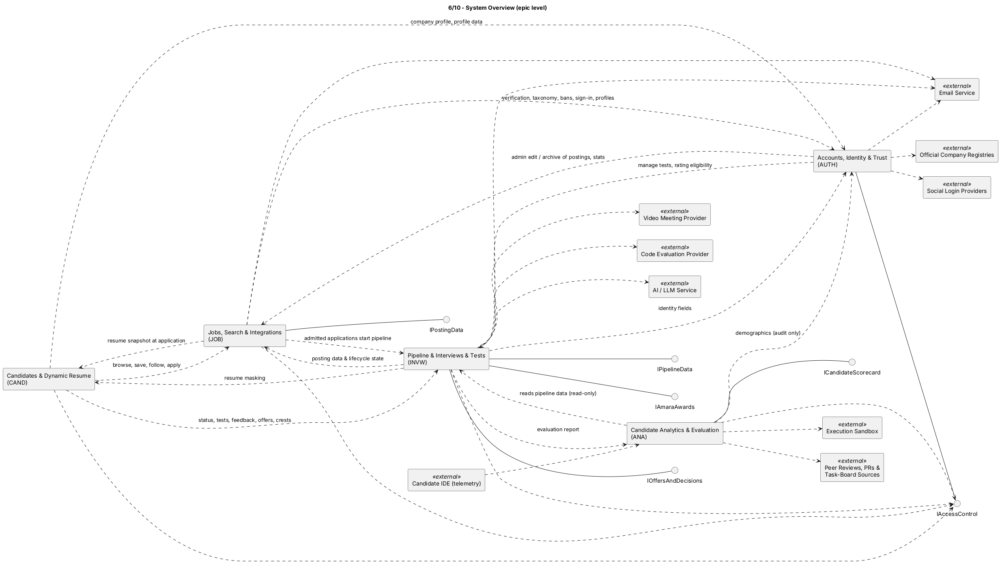

## 3. System architecture

Owner: TBD | Status: Draft | Last updated: 2026-10-14 | Jira: TBD

### 3.1 Architecture drivers

The architecture is driven by the functional ownership boundaries in `docs/srs/05-functional/`, the user workflows in `docs/srs/04-use-cases.md`, and the measurable targets in `docs/srs/06-nfr.md`:

- A student team must be able to build and operate the initial Egypt deployment without running five independent services.
- Account, posting, application, pipeline, assessment, offer, and analytics data must have explicit owners and company scope.
- Slow or unavailable providers must not discard committed submissions or turn missing evaluation data into a failed assessment.
- Deadline-bound and retriable work needs worker capacity and queueing separate from web request capacity.
- The solution must be portable across the AWS/Azure target, use containers, and retain a path to scale beyond T1.
- Candidate identity masking, Arabic/English localization, and accessibility are cross-cutting interface and data-flow concerns.

### 3.2 Chosen style: modular monolith with workers

The backend is one Go codebase and one logical application, partitioned into AUTH, CAND, JOB, INVW, and ANA modules. Each module owns its domain rules, repository write boundary, and public in-process application interfaces. The API process and worker process use the same module contracts; they are separate execution roles, not separately owned microservices. The browser client is a React/Next.js application shipped as an OCI container and served to the user's browser.

This style keeps transactions that cross closely related operations within one backend and one operational release, avoiding early network/service-discovery complexity. Module ownership, interface contracts, and import/write rules preserve separation. Workers can be scaled independently when queues grow; independently deployed services are a later option only if measured load, team ownership, or fault isolation justifies the added network and operational costs.

#### Runtime view

The diagram is a logical runtime view. Internal module calls are in-process; arrows to the queue and provider adapters represent asynchronous or external boundaries. Deployment may run multiple API instances and separate worker replicas over the same data store and queue.

Figure 6. Epic-level module dependencies and interfaces. The source remains in [PlantUML](src/06-view-overview.puml).

### 3.3 Module boundaries and ownership

| Module | Owns | Provides to other modules | Boundary rule |
|---|---|---|---|
| AUTH | Accounts, activation, authentication sessions, company identity/verification, RBAC, account/profile administration. | `IAccessControl`; authenticated identity and company scope. | Other modules ask AUTH/policy middleware to authorize; they do not implement their own role matrix. |
| CAND | Candidate-facing discovery/application-history/progress/result/offer views, verified-skill and crest presentation, dynamic-resume experience. | Candidate commands/queries over CAND-owned experience and profile capabilities. | It displays INVW status/decision state; it does not become a second owner of post-admission status transitions. |
| JOB | Posting content/lifecycle/capacity, accepted application snapshots, initial Must-have screening and admission. | `IPostingData`; admitted-application events and posting data. | It stops at admission for processing. Posting open-position capacity and application cap are distinct values. |
| INVW | Published pipeline versions and execution, assessment/interview results, post-admission application states, feedback/notification policy, Amara awards, finalists and offers. | `IPipelineData`, `IAmaraAwards`, `IOffersAndDecisions`; notification intents/events. | It is the single writer for post-admission application statuses and hiring-workflow notifications. It reads posting data/capacity from JOB. |
| ANA | Defined telemetry, technical/behavioral/integrity analysis, reports, score variance audits. | `ICandidateScorecard` and analytical outputs to authorized consumers. | ANA reads authorized source records; it does not write AUTH/CAND/JOB/INVW domain tables or autonomously change hiring status. |

Module interfaces are typed Go interfaces/application services within the process. No module directly writes another module's owned tables. Cross-module writes are represented as a command to the owning module or an event handled by its worker. Read-only queries may cross boundaries through explicit contracts. Company and application identifiers are carried through these contracts so access checks can enforce tenant scope.

### 3.4 Patterns and request flows

#### Layered modules

Each epic module separates transport/controller handling, application use cases, domain rules/state transitions, and repositories/provider ports. HTTP handlers validate transport input and authorization, then call an application operation. Domain rules are not placed in the web client or duplicated in another epic.

#### Ports and adapters

Email, company-registry lookup, social login, video meetings, code evaluation, AI/LLM, object storage, and analytics sources are accessed through provider interfaces. Adapters translate provider payloads and failures into domain-level results. This supports vendor replacement and test doubles without embedding provider-specific rules in AUTH/JOB/INVW/ANA.

#### Queue and worker pattern

Web/API requests commit bounded synchronous work, then enqueue retriable tasks for slow or deadline-driven operations. Worker handlers are idempotent and retain job state/attempt data. API and worker replicas can scale independently. Initial work categories include INVW notifications/reminders and configured feedback, JOB screening work, ANA reports/analysis, and scheduled retention tasks. The precise queue technology remains a deployment choice.

Where a transaction changes domain state and requires asynchronous notification, the design should use a transactional outbox (or an equivalent durable handoff) so a committed offer/status change cannot lose its notification intent. Delivery retries do not roll back the recorded business state; in-product notices remain available as specified by INVW.

#### State machines and idempotency

JOB owns posting states and application admission. INVW owns post-admission application/offer state transitions. Those transitions are expressed as explicit state-machine operations, validated in the owning module, and committed with the relevant record. Retries carry an idempotency key or stable command identifier where duplicate submission/action risks exist. Capacity and one-pending-offer checks are re-evaluated against current state before an offer is sent.

#### Authorization and privacy enforcement

AUTH establishes authenticated identity, role, and associated company scope. The API applies default-deny authorization before protected reads or writes. Company-scoped repositories require a company context; worker jobs retain the initiating company/application context and do not bypass domain policy. INVW applies identity masking to all pre-reveal hiring projections, including resume copies, notes, scorecards, dashboards, and exports. ANA receives only fields permitted for its declared analysis; demographic data is isolated to bias auditing and is not an input to Candidate ranking or decision scores.

#### Read models and analytics

T1 can use indexed relational reads for most workflows. Analytics/dashboard read models or a read replica are an optional scale path, not a separate write authority. ANA report outputs are published through `ICandidateScorecard`; ANA never writes source-epic state. A derived read model must be rebuildable from authorized source data and must preserve company scope.

### 3.5 Data and persistence approach

- Use the relational store for authoritative transactional records: accounts and company memberships, postings and capacity, immutable application submissions, pipeline versions, stage assignments/results, decisions, offers, and audit/evaluation references.
- Maintain ownership at module/repository boundaries even if the initial deployment uses one physical database. Schema ownership and migration files follow the owning module; analytics may query approved data but has no cross-epic write repository.
- Use object storage for resumes, video responses, and larger artifacts. Store references and metadata in transactional records; validate uploads and enforce lifecycle/retention rules.
- Keep company identifiers and application identifiers on records and enforce tenant predicates for reads, writes, exports, and background jobs.
- Store timestamps in UTC; render according to the viewer's locale and time zone. Amounts retain their posting currency; no silent conversion is performed.
- Keep queue messages minimal: event/aggregate identifiers and necessary routing metadata rather than full resumes, credentials, or unneeded identity fields.

The SRS requires a relational database, tenant-aware data model, object-storage lifecycle, backup/restore targets, and retention policies. It does not choose a specific database engine, schema layout, cloud queue, or object-storage vendor; those choices require an ADR after cost and operational evaluation.

### 3.6 Key interactions

1. **Application admission:** JOB validates and commits a Candidate's submission snapshot, evaluates Must-have criteria, and sends an admitted-application event. INVW creates the application workflow and places it at each entry stage when a published pipeline is available.
2. **Assessment:** INVW creates a stable Candidate/stage test instance, stores answers/artifacts, obtains external evaluator results when required, and does not convert provider failure to a zero score. A completed result is passed to the INVW advancement operation.
3. **Live interview:** INVW coordinates availability, meeting creation, reminders, interview notes and scorecards, then stores score/outcome and applies the stage rule.
4. **Finalist and offer:** INVW determines pipeline completion, reads posting capacity/title through `IPostingData`, maintains the offer/application state, and emits notification jobs. CAND renders the state and submits a Candidate response through `IOffersAndDecisions`.
5. **Anonymity:** AUTH authenticates the hiring user and supplies scope; INVW decides whether identity is disclosed at the configured point; CAND sees only the Candidate's own application data.
6. **Analytics:** ANA consumes authorized assessment/application inputs, writes only ANA-owned results, and supplies reports through `ICandidateScorecard`. It does not set pass/reject/offer states.

### 3.7 Architecture tradeoffs and decisions

| Decision | Benefit | Cost / tradeoff | Rationale for this project |
|---|---|---|---|
| Modular monolith instead of early microservices | One deployable backend, simpler local setup, fewer network and operational failure modes, in-process transactions. | Modules share a release and process; requires strict ownership/import discipline and may need later extraction. | Fits T1 team/budget while epic contracts support future separation if measured needs justify it. |
| Separate API and worker execution roles from one codebase | Web latency and worker throughput can scale separately; slow provider calls and retries do not occupy request handlers. | Requires queue operations, idempotency, monitoring, and duplicate-delivery handling. | Aligns with NFR-SCAL and provider-failure behavior without turning each epic into a service. |
| Relational transactional store plus object storage | Strong consistency for status/offer/application changes; suitable storage lifecycle for large files. | Cross-store uploads need cleanup/retry behavior; relational size and object egress need monitoring. | Matches SRS's relational, immutable submission, and retained-media requirements while keeping media out of row payloads. |
| Provider adapters and in-process epic interfaces | Provider replacement and isolated module tests; no internal network hop per feature call. | Contracts must be versioned and reviewed; adapters add a small amount of indirection. | Meets portability and ownership needs with fewer moving parts than a distributed service mesh. |
| T1 relational reads; optional analytics read model later | Avoids premature replication while leaving a scaling route for reports/dashboards. | A later read model introduces freshness and rebuild concerns. | The SRS makes read models/replicas a Should-scale path rather than a required launch dependency. |
| Queue/outbox for asynchronous effects | Durable retryable work and decoupled provider latency. | Requires an outbox/worker operational loop and observable dead-letter handling. | Protects committed submissions and hiring decisions from provider or worker interruptions. |

### 3.8 Deployment and operational view

Build and deploy versioned OCI images through CI to a one-region AWS or Azure environment. The runtime contains a stateless web/API tier, one or more worker replicas, relational storage, object storage, and a durable queue. Infrastructure is described as code. Staging uses synthetic data; production personal data is not copied to local or CI environments. Logs/traces use request or job correlation identifiers and must not contain secrets, full resumes, or unmasked identity data.

Scaling controls are evidence-driven: load tests validate declared T1 capacity; queue depth, provider failures, database health, storage lifecycle, and cloud spend are observable; backup restore tests measure recovery rather than only backup-job success. Specific thresholds are governed by `docs/srs/06-nfr.md`.

### 3.9 Diagram sources

The architecture uses the PlantUML views already committed under `src/` and their corresponding renders under `img/`. The overview, candidate journey, employer workflow, external-provider boundaries, and security/access view are linked in `02-system-overview.md`. Epic-specific component views are documented in `04-component-diagram/{auth,cand,job,invw,ana}.md`.
