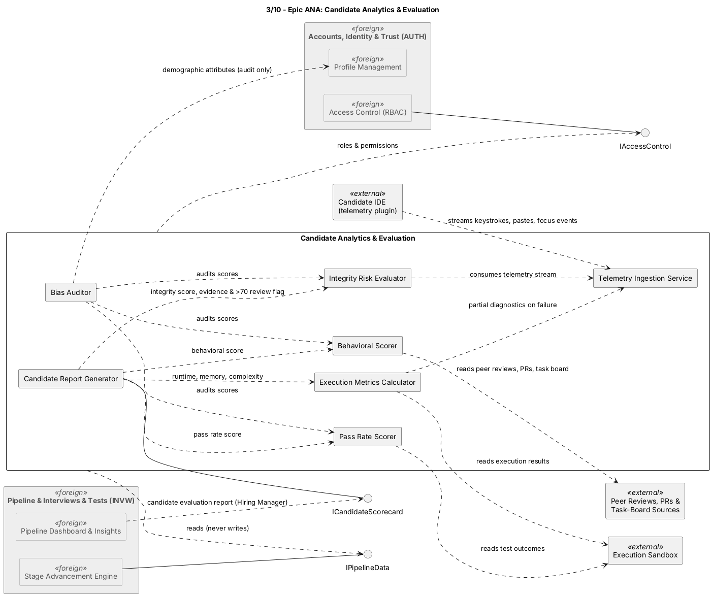

## ANA — Candidate Analytics & Evaluation

### Component view

Figure 1. ANA logical components and dependencies. [PlantUML source](../src/03-epic-ANA.puml).

### Components and responsibilities

| Component in source diagram | Responsibility in the modular monolith |
|---|---|
| Telemetry Ingestion Service | Accepts the defined IDE telemetry stream and applies the configured buffering/validation boundary. |
| Execution Metrics Calculator | Calculates runtime, peak memory, and complexity approximation from sandbox results. |
| Pass Rate Scorer | Derives the technical pass-rate score from test outcomes. |
| Behavioral Scorer | Calculates the configured behavioral score from authorized peer-review/PR/task-board inputs. |
| Integrity Risk Evaluator | Produces the configured risk score/evidence and review flag; it does not by itself set INVW application status. |
| Candidate Report Generator | Aggregates technical, behavioral, and integrity outputs into an authorized evaluation report. |
| Bias Auditor | Audits score variance using authorized demographic fields for the audit purpose only; those attributes are not used for Candidate ranking or stage scores. |

### Interactions and decisions

- IDE telemetry, sandbox outcomes, and peer-review/PR/task-board inputs enter through external adapters and are normalized before analysis.
- ANA produces ANA-owned metrics/reports and supplies a Candidate scorecard/report through `ICandidateScorecard`. INVW owns stage/offer/application outcomes; ANA cannot write those records.
- `IPipelineData` is a read-only access path for ANA. Analytics/report generation should run in workers when it exceeds request budgets.
- Telemetry and demographic data are sensitive. Collection, processor sharing, prompt use, retention, access, and regional storage follow the privacy requirements in `docs/srs/06-nfr.md`.
- On sandbox/provider failure, the evaluator must preserve available diagnostics and represent the run as failed/pending according to the ANA workflow rather than fabricating a successful score.

### Architectural decision

ANA remains an analytical bounded module in the modular monolith for the initial release, but is read-only with respect to source-epic records. Report generation and high-volume telemetry can scale on worker replicas. If ANA's ingestion or compute profile later threatens transactional hiring paths, its stable input/output contracts provide a seam for independent scaling or extraction.

### Related SRS use cases

The ANA component source references telemetry ingestion, execution metrics, technical pass-rate, integrity evaluation, and report generation cases. The consolidated SRS use-case file currently has AUTH, CAND, INVW, and JOB case groups; ANA use-case coverage is not present there yet. ANA functional requirements are in [`docs/srs/05-functional/ana.md`](../../srs/05-functional/ana.md).
