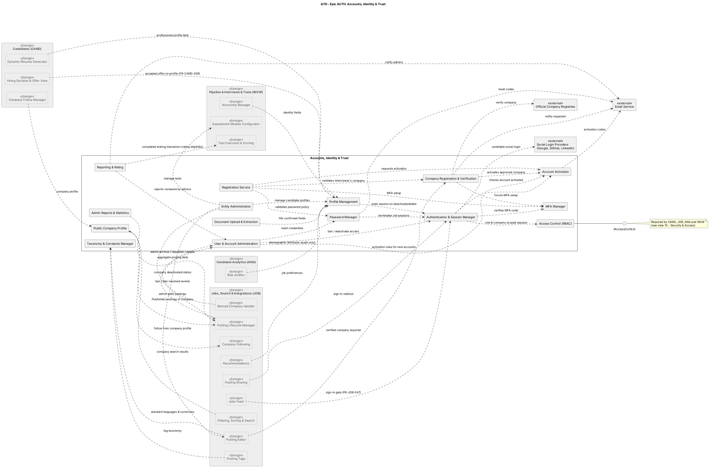

## AUTH — Accounts, Identity & Trust

### Component view

Figure 1. AUTH logical components and dependencies. [PlantUML source](../src/04-epic-AUTH.puml).

### Components and responsibilities

| Component in source diagram | Responsibility in the modular monolith |
|---|---|
| Registration Service | Validates Candidate, Interviewer, and Company Representative registration commands and starts activation/verification flows. |
| Account Activation | Verifies activation codes and controls whether an account can sign in. |
| Company Registration & Verification | Stores company registration requests and coordinates official-registry and admin review. |
| Authentication & Session Manager | Authenticates direct/social-login credentials and establishes sessions with role and company context. |
| MFA Manager | Manages optional account MFA and the mandatory Company Representative/Interviewer rules in AUTH. |
| Password Manager | Applies the password policy, reset workflow, and session invalidation on credential change. |
| Access Control (RBAC) | Supplies the shared `IAccessControl` contract. Protected module operations check permissions and company scope here. |
| Profile Management | Owns Candidate profile data and the account-level profile operations specified by AUTH. |
| Document Upload & Extraction | Validates and stores supported documents; extracted values are applied only after user confirmation. |
| Public Company Profile | Supplies public company information to authorized/public profile views as allowed by AUTH. |
| Reporting & Rating | Records reports/ratings and routes them to the permitted administrative review flow. |
| User & Account Administration | Handles admin operations for accounts, activation, deactivation, banning, and credential reset. |
| Entity Administration | Coordinates permitted admin changes to records owned by other epics through their interfaces. |
| Taxonomy & Constants Manager | Owns platform taxonomies and reference values consumed by posting and profile workflows. |
| Admin Reports & Statistics | Presents permitted aggregate administrative information; it does not replace ANA's source-data ownership. |

### Interactions and decisions

- Registration, activation, password reset, and notification messages are commands/events handled by AUTH and its worker-facing adapters. Email delivery failures do not roll back a committed account or reset state.
- Company checks use the registry adapter and may be completed through the admin review path when needed. A failed/unavailable registry check is not treated as proof that a company is verified.
- Login produces identity, role, activation state, and company context. The shared access-control contract is consumed by CAND, JOB, INVW, and ANA; company-scoped data access is enforced by the receiving module as well as the shared policy.
- Company Representatives must use MFA; Interviewer login enforces the interviewer MFA requirement. These AUTH rules are the source of truth rather than duplicating MFA policy in other epics.
- Administrative actions against postings, tests, or other epic-owned entities are delegated through the owning module's operation so AUTH does not become a cross-epic table writer.

### Architectural decision

AUTH centralizes identity and authorization but does not own hiring application state, Candidate assessment outcomes, posting lifecycle, or analytics findings. Profile/account records remain behind AUTH repositories; other modules receive scoped identity/profile data through explicit contracts. This preserves a single authorization policy while keeping data writes with their owning epic.

### Related SRS use cases

Registration and login: `UC-AUTH-001`–`UC-AUTH-003`; profile/documents: `UC-AUTH-005`–`UC-AUTH-008`; password reset/logout: `UC-AUTH-010`–`UC-AUTH-011`; administration: `UC-AUTH-013`–`UC-AUTH-017` in [`docs/srs/04-use-cases.md`](../../srs/04-use-cases.md).
