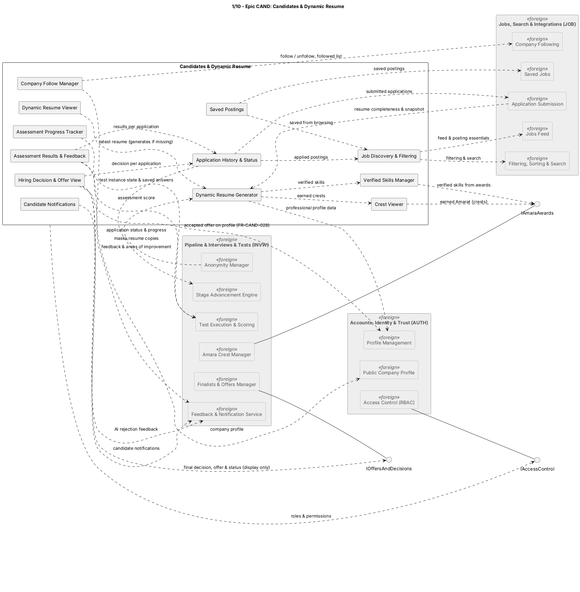

## CAND — Candidates & Dynamic Resume

### Component view

Figure 1. CAND logical components and dependencies. [PlantUML source](../src/01-epic-CAND.puml).

### Components and responsibilities

| Component in source diagram | Responsibility in the modular monolith |
|---|---|
| Job Discovery & Filtering | Candidate-facing discovery/query experience over Published posting data supplied by JOB. |
| Saved Postings | Candidate-owned save/list presentation, using posting identity and lifecycle information from JOB. |
| Company Follow Manager | Candidate-facing follow/unfollow and followed-company list. Company profiles are supplied by AUTH. |
| Application History & Status | Presents a Candidate's own applications. JOB submits/screen-admits; INVW is authoritative for post-admission status and pipeline progress. |
| Assessment Progress Tracker | Presents assessment availability/state and saved progress using INVW assessment data. |
| Assessment Results & Feedback | Displays only results and feedback INVW permits the Candidate to see. |
| Hiring Decision & Offer View | Displays final decisions and offers; sends accept/decline commands through `IOffersAndDecisions`. INVW remains the writer for offer/application states. |
| Crest Viewer | Presents earned Amarat received through `IAmaraAwards`. |
| Verified Skills Manager | Presents skills verified by eligible INVW awards; it does not create an award independently. |
| Dynamic Resume Generator | Composes the Candidate's available profile, verified skills, and earned crests. Profile data is sourced from AUTH. |
| Dynamic Resume Viewer | Displays the latest generated Candidate resume. |
| Candidate Notifications | Presents in-product notification state produced by INVW and other owning modules. |

### Interactions and decisions

- CAND owns candidate-facing presentation and saved/followed state described in CAND. JOB supplies posting records and owns application submission, immutable resume snapshots, screening, and admission.
- INVW supplies admitted-application progress, assessment disclosures, Amara awards, final decisions, and offer states. CAND calls INVW-owned operations for Candidate offer responses and never independently changes these statuses.
- AUTH owns account and profile data and authorizes Candidate access. CAND queries only the signed-in Candidate's permitted records.
- Dynamic-resume generation is a projection over profile and verified-achievement data. It must not alter source profile, assessment, or award records.
- The CAND-side nodes for posting discovery shown in the source diagram are logical Candidate experience components. The SRS ownership boundary is authoritative: CAND owns the presentation; JOB owns posting data/lifecycle, and the respective APIs are in-process contracts in the modular monolith.

### Architectural decision

CAND is a user-experience and Candidate-profile/resume module, not a second application-state service. This keeps the Candidate journey coherent while preventing duplicated status, offer, and assessment writes. Read projections can be optimized separately if the NFR read latency/load targets require it.

### Related SRS use cases

Candidate discovery and history: `UC-CAND-001`–`UC-CAND-007`; offers, achievements, and resume: `UC-CAND-008`–`UC-CAND-014`. These are in [`docs/srs/04-use-cases.md`](../../srs/04-use-cases.md); their functional ownership is cross-referenced in `docs/srs/05-functional/cand.md` and the other owning epics.
