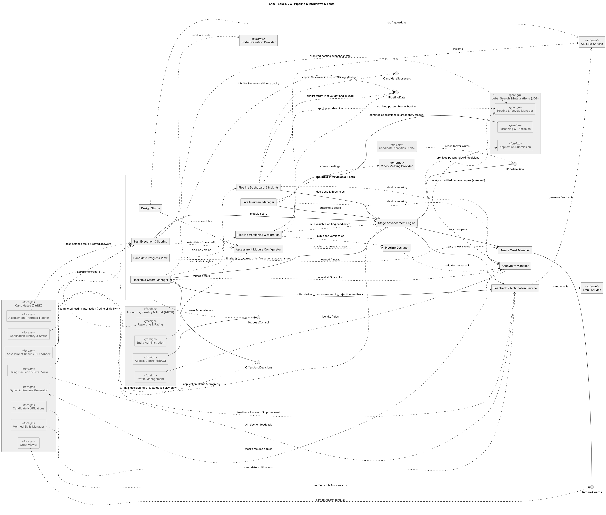

## INVW — Pipeline & Interviews & Tests

### Component view

Figure 1. INVW logical components and dependencies. [PlantUML source](../src/05-epic-INVW.puml).

### Components and responsibilities

| Component in source diagram | Responsibility in the modular monolith |
|---|---|
| Pipeline Designer | Builds the posting's directed acyclic stage graph and stage/module configuration. |
| Assessment Module Configurator | Associates assessment types, content, scoring setup, Amara mappings, and stage configuration. |
| Design Studio | Creates and reviews custom tests, optionally using AI question drafts. |
| Live Interview Manager | Schedules provider meetings and stores outcomes, notes, and scorecards. |
| Pipeline Versioning & Migration | Publishes pipeline versions and migrates in-progress applications while preserving completed results. |
| Test Execution & Scoring | Creates stable Candidate/stage instances, enforces timers, stores submissions, and integrates code evaluation. |
| Stage Advancement Engine | Applies manual, threshold, or completion rules; records decisions and triggers downstream stage/feedback operations. |
| Pipeline Dashboard & Insights | Presents stage counts, Candidate evidence, rankings, and labelled insights to authorized Hiring Managers. |
| Anonymity Manager | Applies configured reveal points and masks identity at every pre-reveal hiring view. |
| Feedback & Notification Service | Owns post-admission notification policy, delivery events/retries, feedback release, and in-product notices. |
| Candidate Progress View | Presents the Candidate's own pipeline version, stages, status, and permitted Amara awards. |
| Amara Crest Manager | Calculates/records configured skill awards, Company association, and award history; shares awards through `IAmaraAwards`. |
| Finalists & Offers Manager | Determines pipeline completion, reads JOB title/capacity, manages finalist decisions and offer state, and shares them through `IOffersAndDecisions`. |

### Interactions and decisions

- `Pipeline Designer`, configurator, and versioning operate on one published pipeline definition at a time. Migration validates changes before applying the new version to in-progress applications.
- `Test Execution & Scoring` and `Live Interview Manager` supply results to the advancement engine. Invalid or unavailable external evaluation results remain pending instead of being converted into zeros.
- The stage engine is the sole writer of post-admission stage transitions. It coordinates awards and notifications after the authoritative decision is committed.
- Anonymity is a projection/security concern: it masks identity for Hiring Managers and Interviewers until the configured point, while Candidate-authored data remains stored as required.
- Finalist and offer state uses INVW's application state machine. The offer manager reads posting capacity/title via `IPostingData`; it does not configure JOB capacity. Offer notifications use the same INVW notification pipeline as decisions and feedback.
- ANA consumes read-only pipeline/evaluation data. Its report interface does not grant ANA write access to INVW's stage, offer, or application state.

### Architectural decision

INVW combines related workflow operations in one bounded module because assessment outcomes, stage transitions, feedback, anonymity, offers, and notifications must agree on application state. The internal interface boundaries support modular tests and worker execution without requiring separate service deployments. Notification and AI tasks are asynchronous; state transitions remain transactional and authoritative in INVW.

### Related SRS use cases

Pipeline, assessment, interview, and advancement: `UC-INVW-001`–`UC-INVW-010`; optional/future cases: `UC-INVW-011`–`UC-INVW-013`; Candidate progress and Amara cases: `UC-INVW-014`–`UC-INVW-016`; finalist/offer flow: `UC-INVW-017`. See [`docs/srs/04-use-cases.md`](../../srs/04-use-cases.md) and [`docs/srs/05-functional/invw.md`](../../srs/05-functional/invw.md).
