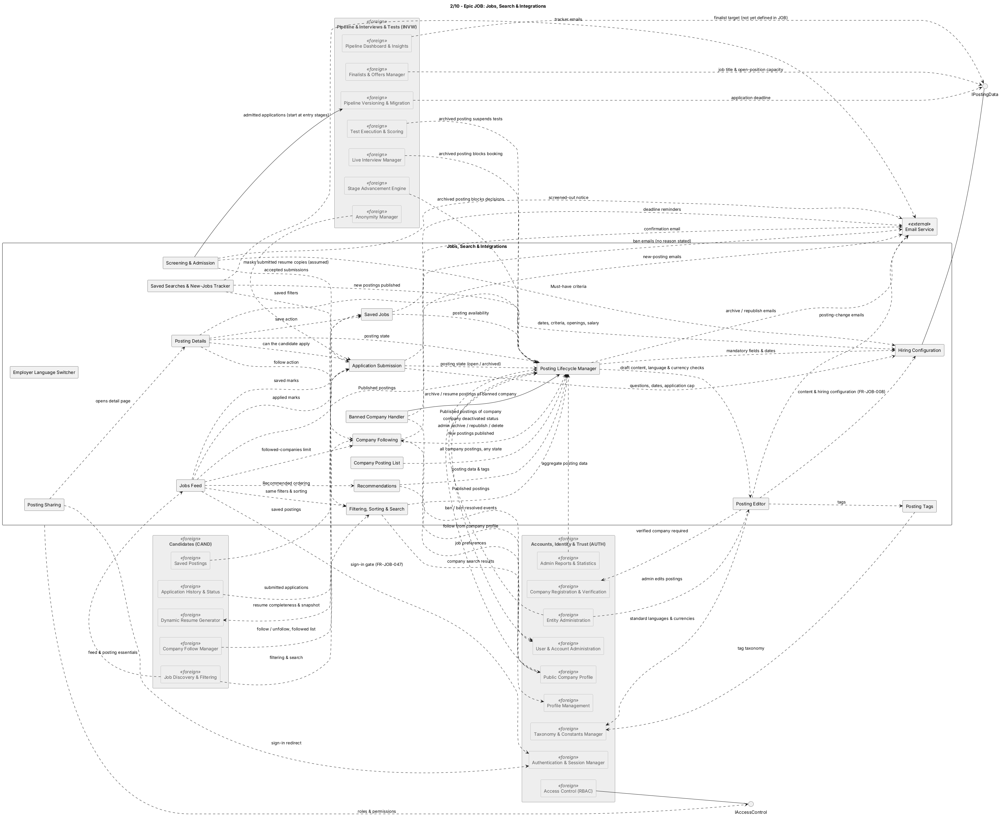

## JOB — Jobs, Search & Integrations

### Component view

Figure 1. JOB logical components and dependencies. [PlantUML source](../src/02-epic-JOB.puml).

### Components and responsibilities

| Component in source diagram | Responsibility in the modular monolith |
|---|---|
| Posting Editor | Draft/edit/preview posting content and coordinate hiring configuration. |
| Employer Language Switcher | Applies employer UI locale without translating authored posting content. |
| Hiring Configuration | Owns dates, open-position count, application cap, criteria, salary visibility, and application questions. |
| Posting Tags | Applies taxonomy-managed posting tags. |
| Posting Lifecycle Manager | Owns Draft/Published/Archived transitions and publication validation. |
| Banned Company Handler | Coordinates posting archival/resumption in response to AUTH company-account state. |
| Company Posting List | Presents the company's postings and lifecycle state to its authorized Hiring Managers. |
| Jobs Feed / Filtering, Sorting & Search / Posting Details | Logical posting-data query components; CAND owns the Candidate-facing discovery and detail experience, while JOB supplies authorized posting data and lifecycle rules. |
| Saved Jobs / Company Following / Recommendations / Saved Searches & New-Jobs Tracker / Posting Sharing | Integrate posting data with CAND-owned Candidate actions and views. JOB supplies the posting identifiers, state, and searchable fields. |
| Application Submission | Validates an application against the posting window, application cap, required questions, and duplicate-active-application rule; commits an immutable resume/answer snapshot. |
| Screening & Admission | Evaluates accepted submissions against structured Must-have criteria and hands admitted applications to INVW. |

### Interactions and decisions

- Posting edit and lifecycle operations are synchronous, validated module commands. Publication reads hiring configuration and taxonomy/verification state from AUTH-owned contracts.
- Application submission commits the application row and resume snapshot before acknowledgment. The submission cap and the open-position capacity are different domain values: JOB owns both; INVW reads the open-position count for finalist/offer checks.
- Screening ends at admission. JOB sends the admitted-application event to INVW; it does not write post-admission stage, offer, or final-decision status.
- Candidate-facing feed, filter, save, follow, and detail interactions use JOB posting data but are presented by CAND, consistent with the functional ownership statements in `job.md` and `cand.md`.
- The PlantUML source contains JOB-to-email dependency arrows for several posting/application events. In the target implementation, these are notification intents routed through INVW's notification ownership/dispatcher; JOB does not own a separate notification policy or provider adapter. The source arrow denotes the event origin, not a second notification subsystem.
- Admin posting changes are invoked through JOB lifecycle operations, preserving the same validation and archival behavior as Hiring Manager actions.

### Architectural decision

JOB owns posting and initial-intake data, while CAND owns the candidate-facing experience and INVW owns the admitted hiring workflow. This split avoids duplicate state machines: a JOB submission is immutable and screened once, then an admitted application is handed to INVW. Posting status/capacity is exposed through `IPostingData` rather than copied as independently editable data in INVW.

### Related SRS use cases

Posting management and intake: `UC-JOB-01`–`UC-JOB-08`, `UC-JOB-16`–`UC-JOB-17`; Candidate-facing discovery and posting actions are described by `UC-CAND-001`–`UC-CAND-003`, `UC-CAND-013`–`UC-CAND-014`. The consolidated cases are in [`docs/srs/04-use-cases.md`](../../srs/04-use-cases.md); requirements are in [`docs/srs/05-functional/job.md`](../../srs/05-functional/job.md).
